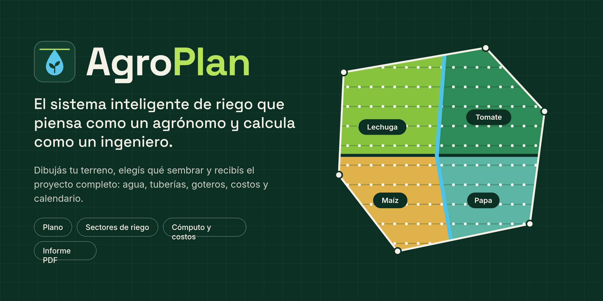

<p align="center">
  
</p>

<p align="center">
  <strong>AgroPlan</strong> · diseño de riego por goteo para quien siembra · <strong>Abstracthon 2026</strong>
</p>

<p align="center">
  
  
  
  
</p>

Dibujás tu terreno. Elegís qué querés sembrar. AgroPlan te devuelve un proyecto de riego por goteo completo: cuánta agua, cuántos metros de tubería, cuántos goteros, cuánto cuesta y cuándo sembrar.

Sin planillas. Sin adivinar. Sin pagar dos veces la misma instalación.

**Y sirve igual si nunca regaste en tu vida, si llevás veinte años sembrando o si firmás proyectos para otros.**

---

## La escena que nos hizo construir esto

Don Julio tiene dos hectáreas y quiere poner goteo.

Le ofrecen un paquete. Le dicen un precio. Le dicen que "alcanza". No le muestran un plano, no le muestran números, no le explican por qué ese tanque y no otro.

Don Julio compra. Y un año después descubre una de dos cosas: o compró el doble de lo que necesitaba, o el agua no alcanza y la mitad de la parcela se queda seca.

Nadie le mintió. Simplemente nadie calculó.

**AgroPlan existe para que ese cálculo exista, se vea y se pueda discutir.**

---

## ¿Qué es AgroPlan?

Una aplicación web donde cualquier persona puede **diseñar su sistema de riego por goteo** en cuatro pantallas simples, y recibir al final un informe con plano, distribución de cultivos, cómputo de materiales y costos.

Lo cotidiano se resuelve solo:

- **Dibujás la parcela** con el mouse, como en un papel.
- **AgroPlan mide** el área, el perímetro y los lados. Vos no escribís números: no podés equivocarte con ellos.
- **Elegís productos y fechas de siembra.** Nada más.
- **Contás qué tenés**: si hay tanque, cuánta energía, cuánto presupuesto.
- **AgroPlan diseña** la distribución, los sectores de riego, la red de tuberías y el cómputo.

Y ahí aparece una inteligencia artificial que recomienda con criterio agronómico, pero que **no toca las medidas**: propone *qué* sembrar y *por qué*; el motor del sistema decide *dónde* y *cuánto*.

---

## Para quién es: un sistema, tres niveles de profundidad

AgroPlan no te obliga a saber. Se adapta a lo que sabés.

| | **Persona corriente** | **Con experiencia en el campo** | **Profesional / técnico** |
|---|---|---|---|
| **Cómo lo usa** | Dibuja el terreno, elige productos y sigue las recomendaciones | Ajusta cultivos, fechas, densidades y restricciones reales | Define sectores, revisa la red, valida caudales y usa el informe como base de propuesta |
| **Qué le resuelve** | No tener que entender de hidráulica para decidir bien | Ordenar en un plan lo que ya sabe por oficio | Tener en minutos el cómputo y el plano que hoy arma a mano en horas |
| **Qué se lleva** | Un plan claro: qué sembrar, cuánta agua, cuánto cuesta | Un diseño que respeta su criterio, con números que cierran | Un informe trazable, con fuentes, advertencias y versiones |

Y un cuarto perfil: **instituciones de extensión y viveros**, que necesitan que todas sus propuestas se presenten igual, con el mismo nivel de detalle y las mismas advertencias.

La misma aplicación, tres formas de pararse frente a ella. Nada de "modo avanzado" escondido: la profundidad aparece a medida que la buscás.

---

## Cómo funciona: cuatro pasos

### 1️⃣ Tu terreno

Dibujás la forma de la parcela.

**AgroPlan hace:** mide el área, el perímetro y los lados. Y si falta el caudal de agua, te lo dice claramente y usa un valor estimado **marcado como estimado**. Nunca te frena por un dato que no tenés a mano.

### 2️⃣ Tus cultivos

Elegís qué querés sembrar y cuándo.

**AgroPlan hace:** controla que el área alcance y te muestra el balance en el momento.

### 3️⃣ Tu sistema

Contás qué tenés: tanque, energía, presupuesto.

**AgroPlan hace:** no inventa recursos que no tenés. Si no hay tanque propio, no aparece un tanque mágico en el plano.

### 4️⃣ Tu informe

Un botón. El sistema trabaja.

**AgroPlan hace:** reparte los cultivos según lo que cada uno consume de verdad, arma los sectores, traza la red, calcula materiales y precios, genera el calendario y te entrega un PDF.

Mientras trabaja, **ves en qué está**: leyendo el contexto, consultando al modelo, validando, calculando precios, armando la red. La espera te informa en vez de dejarte mirando una pantalla congelada.

---

## Lo que te llevás

- 🗺️ **Plano de tu parcela** con los bloques de cultivo y la red de riego, dibujado sobre tu forma real, no sobre un rectángulo ideal.
- 🌾 **Distribución agronómica**: cada producto recibe el área que su consumo de agua permite sostener. No es un reparto parejo: el maíz y la lechuga no necesitan lo mismo, y el sistema lo sabe.
- 💧 **Sectores de riego** agrupados con criterio de caudal y superficie.
- 🔧 **Cómputo de materiales** con precios y costos.
- 📅 **Calendario de siembra** y manejo.
- 📄 **Informe en PDF**, con recomendaciones, fuentes y advertencias.

---

## Por qué podés confiar en los números

Esta es la parte que nos importa más que ninguna otra función.

**Todos los números salen de tu terreno.**
El área y el perímetro se calculan a partir de lo que dibujaste. Si alguien intenta cambiar una medida "a mano" por atrás, el sistema la rechaza. No es rigidez: es que un informe con números inventados no sirve para tomar decisiones.

**La inteligencia artificial no dibuja ni mide.**
La IA recomienda cultivos, variedades y manejo, y explica por qué. Pero no tiene permitido devolver polígonos, áreas ni caudales. Si un modelo intenta inventar una medida, el sistema la descarta. Ese es el error más común de la IA generativa —texto impecable con números falsos— y es exactamente lo que AgroPlan no permite.

**Si un dato falta, se dice.**
Caudal asumido, precio desactualizado, cultivo fuera de catálogo: todo aparece marcado en el informe. Nunca un supuesto disfrazado de certeza.

**El documento declara lo que es.**
Todos los informes llevan la marca **"Estimación preliminar"**. No vendemos un plano de obra firmado: entregamos una estimación sólida, auditable y presentable, que un profesional puede revisar y adoptar.

**Se puede repetir y auditar.**
Cada corrida queda guardada con su entrada, su modelo, sus versiones y las fuentes usadas. El mismo proyecto no se calcula dos veces distinto, ni se paga dos veces.

---

## Una IA con criterio agronómico (y sin excusas)

- Trabaja sobre **fichas técnicas curadas de cultivos** —ciclo, densidad, consumo, aptitud de suelo— en vez de improvisar con la memoria del modelo.
- Cita **fuentes** cuando investiga, y esas fuentes quedan guardadas con el informe.
- Corrige y normaliza su propia salida **antes** de que llegue al diseño: el proyecto se arma con datos validados, no con la primera respuesta del modelo.
- **Funciona incluso sin conexión a un modelo de IA.** Si no hay credenciales, cae a un modo de catálogo determinístico y lo informa en lenguaje claro. Una demo, un taller o una oficina sin internet no se caen: cambia la riqueza de la recomendación, no la existencia del proyecto.

---

## Verlo funcionando (4 minutos)

1. **El problema** — Don Julio y el paquete que nadie calculó.
2. **El terreno** — dibujar la parcela y ver el área aparecer sola.
3. **Los cultivos** — elegir productos y fechas; el balance de área en vivo.
4. **El sistema** — declarar tanque, energía y presupuesto.
5. **La corrida** — disparar el informe y ver las fases del trabajo real.
6. **El resultado** — bloques que siguen la forma del terreno, sectores, red, materiales, costos y PDF.

Guion completo: [`docs/pitch-demo-4min.md`](docs/pitch-demo-4min.md)

---

## Bajo el capó (para quien quiera mirar adentro)

Si te interesa la ingeniería, esto es lo que hay detrás:

- **Frontend:** Angular 22 (standalone + signals, SSR) y Tailwind 4. Los planos se dibujan en SVG a partir de la geometría real.
- **Backend:** FastAPI + SQLAlchemy 2 + Alembic sobre PostgreSQL (SQLite en desarrollo). PDF con ReportLab.
- **Motor propio:** geometría, zonificación, sectores, red, hidráulica básica y cómputo de materiales, con versión de motor registrada en cada informe.
- **Agente:** Agno contra un gateway compatible con OpenAI, con timeout, reintentos y una capa de validación propia que corre incluso en el modo sin IA.
- **Trazabilidad:** cada corrida guarda entrada, salida, hash, modelo, versiones, tokens y fuentes.
- **Pruebas:** 26 archivos de prueba en backend y 29 en frontend, con la suite corriendo sin gastar tokens.

El detalle técnico completo —contratos de API, invariantes de geometría, modelo de datos y decisiones de arquitectura— está en [`docs/flujo-sistema-agroplan.md`](docs/flujo-sistema-agroplan.md).

### Levantarlo en tu máquina

```bash
# Backend  →  http://localhost:8000  (documentación interactiva en /docs)
cd backend
uv sync
uv run alembic upgrade head
uv run fastapi dev app/main.py

# Frontend  →  http://localhost:4200
cd frontend
npm install
npm start
```

Las credenciales del modelo y de Google se configuran por entorno. **Sin clave de IA el sistema funciona igual**, en modo catálogo.

---

## Lo que todavía no hace

Preferimos decirlo nosotros:

- La **presión de la red** se estima con una fórmula simple a partir de la bomba; todavía no calcula pérdidas por tramo.
- El **plano gráfico** se ve en la aplicación; en el PDF figura como pendiente.
- El **catálogo de cultivos** está curado a 15 fichas; fuera de ahí, la recomendación baja de nivel y lo advierte.
- Los **precios de materiales** vienen de una base con origen y fecha, no de un cotizador en vivo.

Lo que sí hace, lo hace completo y decirlo: eso también es parte del producto.

---

## Documentación

| Documento | Qué encontrás |
|---|---|
| [`docs/flujo-sistema-agroplan.md`](docs/flujo-sistema-agroplan.md) | Contrato técnico: flujo, API, invariantes y arquitectura. |
| [`docs/pitch-demo-4min.md`](docs/pitch-demo-4min.md) | Narrativa del pitch y guion de demo minuto a minuto. |
| [`PRD-Visual-AgroPlan.md`](PRD-Visual-AgroPlan.md) | Diseño de pantallas, sistema visual y reglas de navegación. |
| [`odd/tasks/`](odd/tasks) | Especificaciones por funcionalidad, con requisitos y bitácora de decisiones. |
| [`frontend/DESIGN.md`](frontend/DESIGN.md) | Sistema de diseño aplicado en la interfaz. |

---

## Equipo

**AgroPlan — Abstracthon 2026.**

Construido en equipo; la historia del repositorio registra los aportes de Alexbyxd, Alex B. Castellon, Aylin, Axel Rolando Lopez Bustamante, AylinNicol, Lopez-Axel y JeffQuin.

---

<p align="center"><sub>AgroPlan · que el agua alcance, que el número cierre y que se pueda mostrar.</sub></p>
