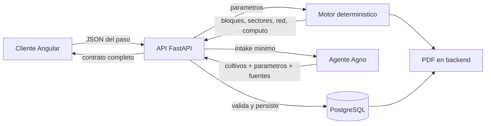
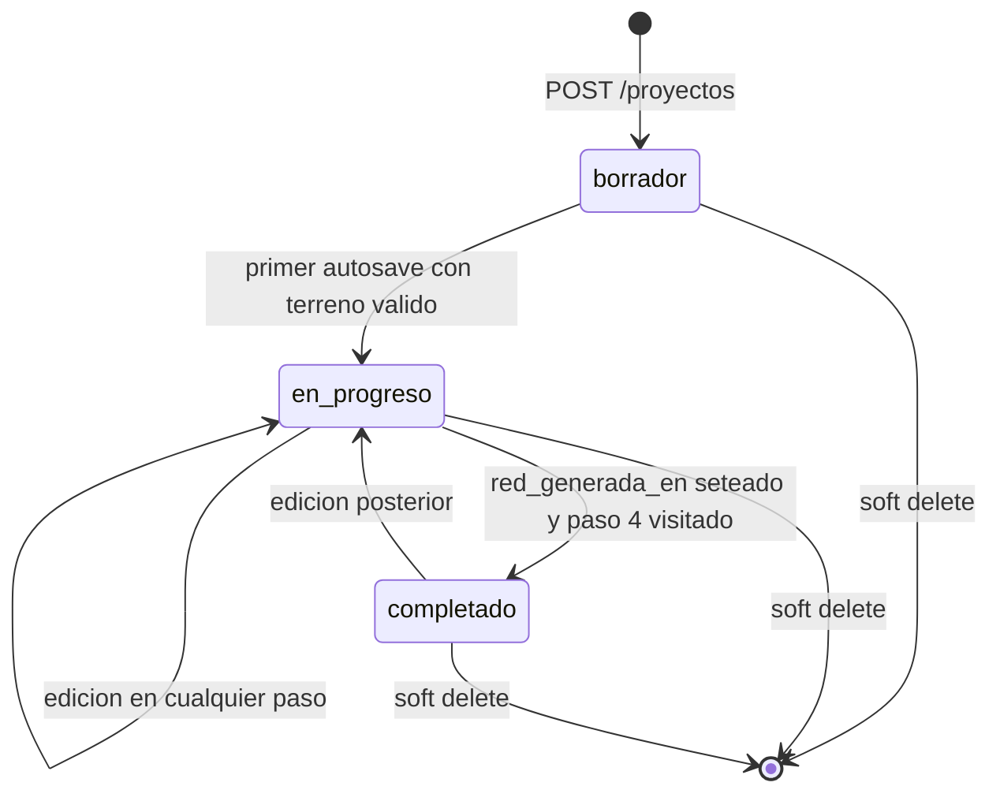

# Flujo del sistema — AgroPlan

Documento de referencia del flujo completo de AgroPlan: qué hace el cliente, qué hace el
backend, qué hace el agente y qué hace el motor determinístico, con los contratos de datos de
cada paso.

> **Estado de la implementación.** Hoy existe el módulo `usuarios` (auth Google + JWT) y el
> esquema de datos del dominio agrícola (13 tablas, migración `736aa2b57e30`). Todo lo demás de
> este documento es **contrato propuesto**: describe cómo debe comportarse el sistema, para que
> backend y agente se construyan contra él. Las marcas `[existe]` y `[contrato]` lo indican.

Cada sección sigue el mismo orden: qué ve el cliente → qué manda → qué valida el backend →
qué devuelve → qué se persiste → qué falla y cómo degrada.

---

## Índice

1. [Actores y responsabilidades](#1-actores-y-responsabilidades)
2. [Flujo completo en una vista](#2-flujo-completo-en-una-vista)
3. [El caudal disponible: la pieza transversal](#3-el-caudal-disponible-la-pieza-transversal)
4. [Paso 0 — Autenticación](#4-paso-0--autenticación)
5. [Paso 1 — Proyectos](#5-paso-1--proyectos)
6. [Paso 2 — Terreno](#6-paso-2--terreno)
7. [Paso 3 — Intake y corrida del agente](#7-paso-3--intake-y-corrida-del-agente)
8. [Paso 4 — Cultivos](#8-paso-4--cultivos)
9. [Paso 5 — Sistema de riego y sectores](#9-paso-5--sistema-de-riego-y-sectores)
10. [Paso 6 — Resultado y PDF](#10-paso-6--resultado-y-pdf)
11. [El agente en detalle](#11-el-agente-en-detalle)
12. [El motor determinístico en detalle](#12-el-motor-determinístico-en-detalle)
13. [Modelo de datos y qué pantalla escribe qué](#13-modelo-de-datos-y-qué-pantalla-escribe-qué)
14. [Contratos de API](#14-contratos-de-api)
15. [Catálogo de advertencias](#15-catálogo-de-advertencias)
16. [Caso completo con números](#16-caso-completo-con-números)
17. [Reglas transversales e invariantes](#17-reglas-transversales-e-invariantes)
18. [Qué falta y qué está fuera de alcance](#18-qué-falta-y-qué-está-fuera-de-alcance)
19. [Glosario](#19-glosario)
20. [Especificación técnica del agente](#20-especificación-técnica-del-agente)

---

## 1. Actores y responsabilidades

| Actor | Qué hace | Qué NO hace |
|---|---|---|
| **Cliente** (Angular) | Captura datos, dibuja el contorno del terreno, pinta lo que el backend le devuelve, edita la propuesta | No calcula áreas, caudales, materiales ni geometría |
| **API** (FastAPI) | Autentica, valida, persiste, orquesta, resuelve derivados | No dibuja |
| **Agente** (Agno + gateway OpenAI-compatible) | Investiga, elige cultivos, propone parámetros de riego y justifica con fuentes | **No devuelve geometría ni cifras de diseño finales** |
| **Motor determinístico** (Python puro, `services/motor/`) | Calcula polígonos, sectores, red, caudales, tiempo de riego, autonomía y cómputo | No llama al LLM |
| **PostgreSQL / SQLite** | Estado del proyecto (14 tablas) y snapshot de cada corrida | — |
| **Generador de PDF** (backend) | Imprime el grafo ya calculado | No recalcula nada |



**La regla que ordena todo:** el LLM decide *qué* y *por qué*; el motor decide *dónde* y *cuánto*.
Si el agente devolviera coordenadas, el plano sería ficción con formato de JSON.

---

## 2. Flujo completo en una vista

```
[Cliente]  login Google ─┐
                         ▼
              ┌──────────────────────┐
              │  P1 · Proyectos      │  lista, crea, duplica, elimina
              └──────────┬───────────┘
                         ▼
              ┌──────────────────────┐
              │  P2 · Terreno        │  contorno + suelo + fuente de agua + caudal (opcional)
              └──────────┬───────────┘   → deriva area_m2, perimetro_m, lados
                         ▼
              ┌──────────────────────┐
   intake     │  P3 · Agente         │  productos deseados + area + suelo + agua + zona
              └──────────┬───────────┘   202 + polling → PropuestaAgente (sin geometría)
                         ▼
              ┌──────────────────────┐
   motor      │  Distribución        │  agent.cultivos + terreno → bloques con polígono
              └──────────┬───────────┘
                         ▼
              ┌──────────────────────┐
              │  P4 · Cultivos       │  revisa bloques, fechas, demanda; balance de area
              └──────────┬───────────┘
                         ▼
              ┌──────────────────────┐
              │  P5 · Sistema        │  goteo, tanque, bomba, emisor, separaciones, sectores
              └──────────┬───────────┘   → motor: red + computo + preview hidraulico
                         ▼
              ┌──────────────────────┐
              │  P6 · Resultado      │  plano final, calendario, PDF
              └──────────────────────┘
```

Un proyecto se reabre siempre en **último paso completado + 1**. Nada se pierde al retroceder:
cada paso persiste de forma independiente y el `PATCH` de cabecera solo mueve el puntero.

### Máquina de estados del proyecto



`estado` es de presentación; lo que manda para habilitar botones es
`ultimo_paso_completado` (0–4) y `sistemas_riego.red_generada_en` (nulo = falta generar la red).

---

## 3. El caudal disponible: la pieza transversal

Es el dato más delicado del sistema porque lo consume **todo** (bomba, sectores, tiempo de
riego, autonomía, advertencias del agente, PDF) y porque el cliente puede perfectamente no
saberlo.

### 3.1 Regla

El cliente **puede** informarlo, no es obligatorio. El sistema siempre tiene un valor efectivo.

| Situación | `caudal_disponible_m3h` | `caudal_efectivo_m3h` | `caudal_origen` | `caudal_base_fuente` |
|---|---|---|---|---|
| El cliente lo informa | el valor | el mismo valor | `cliente` | `NULL` |
| No lo informa | `NULL` | asignado por el sistema | `asumido` | la fuente de agua |
| Lo borra explícitamente | `NULL` | recalculado por el sistema | `asumido` | la fuente de agua |

Un `CHECK` de base (`ck_terrenos_caudal_coherente`) impide cualquier otra combinación: o lo puso
el cliente, o lo asumió el sistema con fuente registrada. Nunca ambos ni ninguno.

### 3.2 Tabla de referencia (constante del motor, versionada con `motor_version`)

| `fuente_agua` | `caudal_referencia_m3h` |
|---|---|
| `red` | 3,0 |
| `pozo` | 1,5 |
| `cisterna` | 1,0 |
| `tanque` | 1,0 |
| `pila` | 0,5 |

### 3.3 Las cinco reglas de resolución

1. `PUT /terreno` **sin** el campo → se asigna por tabla, `origen='asumido'`, `base=fuente`.
2. `PUT /terreno` **con** valor → se guarda tal cual, `origen='cliente'`, `base=NULL`.
3. `PUT /terreno` con `caudal_disponible_m3h: null` explícito → vuelve a `asumido`.
4. Cambia `fuente_agua` y `origen='asumido'` → se recalcula con la fuente nueva.
5. Cambia `fuente_agua` y `origen='cliente'` → **se conserva** el valor del cliente y se emite
   `CAUDAL_NO_RECALCULADO`.

El front distingue "campo ausente" de "campo nulo" con `model_fields_set`; el schema lo expone
como `TerrenoUpdate.limpia_caudal`.

### 3.4 Escalera de degradación (nunca falla por caudal)

| Condición | Qué hace el motor | Advertencia |
|---|---|---|
| `caudal × 24 h ≥ demanda_día` | diseño normal | — |
| `caudal × 16 h < demanda_día ≤ caudal × 24 h` | diseño igual, riego extenso | `RIEGO_NOCTURNO_EXTENSO` |
| `caudal × 24 h < demanda_día` | más sectores/turnos; si no alcanza, reduce el área regada | `DEMANDA_EXCEDE_CAUDAL` |
| `caudal < caudal mínimo del emisor` | único caso bloqueante | `CAUDAL_INSUFICIENTE` |

Regla dura: **un valor `asumido` nunca produce una advertencia bloqueante**. Bloquear a un cliente
por un número que inventó el sistema es encerrarlo sin que haya hecho nada mal.

---

## 4. Paso 0 — Autenticación

`[existe]`

### Cliente
Pantalla de login con un botón de Google. Sin formulario de usuario y contraseña: el backend no
tiene contraseñas, solo identidad federada.

### Lo que manda

```json
POST /auth/google
{ "id_token": "<google id_token>" }
```

### Lo que valida
- Firma y claims del `id_token` contra `GOOGLE_CLIENT_ID`.
- Usuario existente y activo.

### Lo que devuelve

| Caso | Código | Cuerpo |
|---|---|---|
| Usuario registrado y activo | `200` | `{ access_token, token_type: "bearer", usuario: UsuarioOut }` |
| Token de Google inválido | `401` | `{ detail: "..." }` |
| Email no registrado | `403` | `{ detail: "..." }` |
| Usuario inactivo | `403` | `{ detail: "..." }` |

`POST /auth/google/register` da `201` y crea con `rol=cliente`, `activo=true`.

### Token
JWT HS256, claims `sub` (id numérico), `rol`, `iat`, `exp`; 60 minutos. El front lo guarda y lo
manda como `Authorization: Bearer <token>` en cada llamada.

### Qué se persiste
`usuarios` (ya existente): `id`, `google_sub`, `email` único, `email_verificado`, `nombre`,
`foto_url`, `rol`, `activo`, `creado_en`, `actualizado_en`, `ultimo_acceso`.

### Regla de oro para todo el resto
`usuario_id = token.sub`. Cada consulta de proyecto filtra por dueño y responde **404**, no 403,
cuando el proyecto es de otro: no se confirma la existencia de recursos ajenos.

---

## 5. Paso 1 — Proyectos

`[contrato]` — el frontend hoy trabaja con fixtures en memoria.

### Cliente
Grilla de tarjetas. Cada tarjeta muestra: nombre, área en hectáreas, cantidad de cultivos, sistema
de riego, fecha de última modificación y menú `···` (Duplicar · Exportar · Eliminar).

Estado vacío obligatorio: una tarjeta punteada `+ Nuevo proyecto` con "Creá tu primer plano".

### Lo que manda

```json
POST /proyectos
{ "nombre": "Mi parcela", "zona": "Mendoza", "unidad": "metric" }
```

`nombre` requerido, ≤60. `zona` opcional, ≤120. `unidad` es `metric` o `imperial`; el motor calcula
siempre en métrico e imperial es solo presentación.

### Lo que devuelve
`201` con `ProyectoOut` (`id` uuid, `version: 1`, `paso_actual: 1`, `ultimo_paso_completado: 0`,
`estado: "borrador"`, timestamps). Al confirmar, el cliente entra al paso 2.

La grilla usa `ProyectoListadoOut`, que trae los derivados ya calculados:

```json
{ "id": "uuid", "nombre": "Mi parcela", "zona": "Mendoza", "unidad": "metric",
  "estado": "en_progreso", "area_m2": 3200, "cultivos_count": 2, "sistema_tipo": "goteo",
  "ultimo_paso_completado": 2, "actualizado_en": "2026-11-21T11:06:00-03:00", "version": 7 }
```

`statusLabel`, `statusIcon`, `statusTone`, `headerTone`, `sectorsLabel`, `hydraulicSpecs` y
`preview` **no** los devuelve el backend: son view-model que arma el front a partir de `estado`,
del paso y de los conteos.

### Qué se persiste
`proyectos`. `version` arranca en 1 y sube en cada escritura: es el mecanismo de concurrencia
optimista del autosave.

### Acciones de la tarjeta

| Acción | Efecto |
|---|---|
| Duplicar | Copia terreno, bloques de cultivo y parámetros de sistema. **No** copia sectores ni red: se regeneran |
| Exportar | `POST /proyectos/{id}/pdf` |
| Eliminar | `DELETE` con confirmación → soft delete (`eliminado_en`), nunca borrado físico |

### Errores
- Autosave con `version` vieja → `409` con la versión actual; el front recarga y reintenta.
- Error de carga de la grilla → mensaje con botón `Reintentar`.

---

## 6. Paso 2 — Terreno

`[contrato]`

### Cliente
Panel izquierdo con formulario, canvas central con el plano 2D, panel derecho con derivados y
validaciones. El contorno **lo dibuja o lo tipea el cliente**: es la única fuente de verdad
geométrica del sistema.

| Campo | Tipo | Regla |
|---|---|---|
| Nombre de parcela | texto | requerido, ≤60 |
| Forma | `rectangulo` \| `trapecio` \| `poligono` | default `rectangulo` |
| Vértices | interacción + tipeo de medidas | mínimo 3, máximo 30, se cierran solos |
| Tipo de suelo | `franco` \| `arenoso` \| `arcilloso` \| `limoso` | requerido; afecta la infiltración |
| Pendiente | numérico % | 0–30, default 0 |
| Fuente de agua | `pila` \| `pozo` \| `red` \| `cisterna` \| `tanque` | requerido |
| Caudal disponible | numérico m³/h | **opcional**, >0, ≤50 |

Si el cliente elige rectángulo o trapecio, tipea largo y ancho y el canvas dibuja solo. Si elige
polígono libre, arrastra vértices. En los dos casos el front manda **vértices**, nunca áreas.

### Lo que manda

```json
PUT /proyectos/{id}/terreno
{
  "nombre_parcela": "Mi parcela",
  "forma": "rectangulo",
  "vertices": [
    { "x": 0,  "y": 0  },
    { "x": 60, "y": 0  },
    { "x": 60, "y": 30 },
    { "x": 0,  "y": 30 }
  ],
  "suelo_codigo": "franco",
  "pendiente_pct": 1,
  "fuente_agua": "pozo",
  "caudal_disponible_m3h": null
}
```

### Lo que valida
- Autointersección del contorno → `422` + `autointerseccion`, bloqueante.
- Área mínima 100 m², lados ≤2000 m, pendiente 0–30, `caudal > 0`.
- `suelo_codigo` y `fuente_agua` dentro del dominio (lo impone la base además del schema).
- **Rechaza con `422` cualquier campo derivado**: `area_m2`, `perimetro_m`, `lados` (los schemas
  de entrada usan `extra="forbid"`).

### Lo que devuelve

```json
{
  "id": "uuid",
  "area_m2": 1800,
  "perimetro_m": 172.4,
  "lados": 4,
  "lados_m": [
    { "desde": 0, "hasta": 1, "longitud_m": 60 },
    { "desde": 1, "hasta": 2, "longitud_m": 30 }
  ],
  "caudal_efectivo_m3h": 1.5,
  "caudal_origen": "asumido",
  "caudal_sugerido_m3h": 1.5,
  "caudal_rango_sugerido_m3h": { "min": 0.5, "max": 3.0 },
  "alertas": [
    { "codigo": "CAUDAL_ASUMIDO",
      "mensaje": "Caudal asignado en 1,5 m³/h según fuente «pozo». Podés ajustarlo.",
      "bloqueante": false }
  ]
}
```

El front muestra el caudal como "1,5 m³/h (asignado) · editar", con el sugerido como placeholder.

### Qué se persiste
`terrenos` con `geometria` (jsonb, forma documentada) y los derivados. El área se calcula una vez
al escribir, no se recalcula en cada lectura.

### Bloqueo de avance
`Continuar →` deshabilitado mientras no haya un terreno con área válida. El tooltip explica el
motivo: "Necesitás un terreno para continuar".

### Cambio de fuente de agua después de generar la red
Si el cliente vuelve y cambia `pozo → red`, el motor deja la red como está y marca
`SISTEMA_DESACTUALIZADO` en el paso 5: la red se generó con otro caudal.

---

## 7. Paso 3 — Intake y corrida del agente

`[contrato]` — es el corazón del producto.

### Cliente
El cliente confirma **qué quiere sembrar** (los productos), y ve los datos que ya vienen del paso
anterior: área, suelo, fuente de agua, zona. Aprieta **Analizar**.

### Entrada mínima — 5 obligatorios + 1 opcional

| # | Dato | Origen | Obligatorio |
|---|---|---|---|
| 1 | `productos[]` | lo escribe el cliente | sí |
| 2 | `area_m2` | derivado del terreno | sí |
| 3 | `suelo_codigo` | paso 2 | sí |
| 4 | `fuente_agua` | paso 2 | sí |
| 5 | `zona` | modal del proyecto | sí para buenas recomendaciones |
| 6 | `caudal_efectivo_m3h` | resuelto por el backend | siempre presente |

El cliente nunca manda el caudal: lo manda el backend ya resuelto, con su origen.

### Lo que manda

```json
POST /proyectos/{id}/agente
{
  "productos": [
    { "nombre": "papa",    "prioridad": 1, "area_deseada_m2": null },
    { "nombre": "lechuga", "prioridad": 2, "area_deseada_m2": null }
  ],
  "area_m2": 3200,
  "suelo_codigo": "franco",
  "fuente_agua": "pozo",
  "caudal_m3h": 1.5,
  "caudal_origen": "asumido",
  "zona": "Mendoza, AR",
  "pendiente_pct": 1
}
```

### Lo que devuelve inmediatamente

```json
202 Accepted
{ "corrida_id": "uuid", "estado": "corriendo", "intake_hash": "sha256..." }
```

El agente tarda entre 5 y 30 segundos. **No se bloquea el request**: el front hace polling.

### Polling

```
GET /agente/corridas/{corrida_id}
```

```json
{ "id": "uuid", "estado": "corriendo", "progreso": "investigando" }
```

Estados: `pendiente` → `corriendo` → `ok` | `error`. Con `estado: ok`, la corrida trae el resultado.

### El resultado (PropuestaAgente)

```json
{
  "cultivos": [
    {
      "cultivo_codigo": "papa",
      "nombre": "Papa",
      "color": "#8D6E63",
      "area_m2": 2240,
      "demanda_l_m2_dia": 2.0,
      "ciclo_dias": 120,
      "siembra_sugerida": "2026-03-15",
      "cosecha_sugerida": "2026-07-15",
      "justificacion": "Suelo franco, 1 % de pendiente y ciclo compatible con la ventana de siembra de la zona.",
      "fuente_ids": [1, 3]
    }
  ],
  "sistema": {
    "tipo": "goteo",
    "emisor": { "tipo": "gotero", "caudal_lh": 2.0, "separacion_m": 0.2 },
    "separacion_laterales_m": 5,
    "tanque_l": 5000,
    "bomba_hp": 1,
    "num_sectores": 2
  },
  "advertencias": [
    { "codigo": "CAUDAL_ASUMIDO", "mensaje": "El caudal es una estimación según la fuente.", "bloqueante": false }
  ]
}
```

`area_m2` en un cultivo es una **asignación propuesta**, no un área calculada: el motor la convierte
en polígonos y el área derivada de la geometría es la que manda.

### Re-corrida y obsolescencia

`agente_corridas.intake_hash` es el SHA-256 del intake canónico. Reglas:

- Si el cliente vuelve a apretar **Analizar** con el mismo intake, se responde la corrida vigente
  (`intake_hash` igual) en lugar de gastar otra llamada.
- Si cambian productos, área, suelo, caudal o zona, el hash cambia y la propuesta vigente queda
  **desactualizada**: el front muestra "Los datos cambiaron: volvé a analizar" y no deja avanzar
  con una recomendación calculada sobre otra cosa.

### Qué se persiste
`agente_corridas` (entrada, salida, modelo, `motor_version`, `prompt_version`, hash, tokens,
duración, timestamps), `agente_recomendaciones` (una fila por recomendación y por advertencia,
con `aplicada` en falso) y `agente_fuentes` (cada fuente citada). `proyectos.corrida_actual_id`
apunta a la última corrida aplicada.

### Aplicar la propuesta

```
POST /agente/corridas/{corrida_id}/aplicar
```

Escribe en las tablas normalizadas: los bloques en `proyecto_cultivos`, los parámetros en
`sistemas_riego`, las recomendaciones marcadas como aplicadas y `proyectos.corrida_actual_id`.
Solo después de aplicar existen bloques que el cliente pueda editar en el paso 4.

### Fallas

| Situación | Comportamiento |
|---|---|
| Gateway sin respuesta / timeout | `estado: error`, `error_detalle` guardado; el front ofrece reintentar |
| El modelo devuelve algo fuera del schema | Se reintenta una vez con el error de validación; si vuelve a fallar, `error` |
| El agente falla del todo | Se ofrece el **modo catálogo**: el motor reparte según el catálogo local sin justificación ni fuentes, marcado como recomendación sin agente |
| Sin red para buscar | La corrida sigue; se marcan las fuentes como ausentes y la confianza baja |

El modo catálogo existe para que la demo nunca se quede sin plano por depender de internet.

---

## 8. Paso 4 — Cultivos

`[contrato]`

### Cliente
Panel izquierdo con la lista de bloques y sus campos, canvas central con la distribución pintada,
panel derecho con el balance de área, el calendario, los solapes y la demanda hídrica.

### Qué hay en pantalla al entrar
Los bloques que generó el motor a partir de la propuesta del agente, ya recortados dentro del
terreno y sin solapes. El cliente **no empieza de cero**: edita.

| Campo por bloque | Regla |
|---|---|
| Cultivo | código del catálogo |
| Área | derivada del polígono, solo lectura |
| Siembra | fecha |
| Cosecha | posterior a siembra |
| Demanda | L/m²/día, default del catálogo, editable con aviso |

### Dos modos de reparto, mutuamente excluyentes

1. **Editar el polígono**: el cliente mueve los vértices del bloque propuesto. El front manda el
   anillo nuevo; el backend valida y recalcula el área.
2. **Por porcentaje**: un slider por cultivo y el motor vuelve a repartir el terreno.

### Lo que manda

```json
POST /proyectos/{id}/cultivos
{
  "cultivo_codigo": "papa",
  "siembra": "2026-03-15",
  "cosecha": "2026-07-15",
  "demanda_l_m2_dia": 2.0,
  "modo": "porcentaje",
  "porcentaje": 70
}
```

o, en modo polígono:

```json
{ "modo": "poligono", "poligono": { "anillo": [[0,0],[40,0],[40,30],[0,30]] } }
```

### Lo que valida
- El polígono cae dentro del terreno y no se superpone con otro bloque.
- `cosecha > siembra`.
- `demanda ≥ 0`.
- La suma asignada no puede superar el área del terreno.

### Lo que devuelve (siempre el balance completo)

```json
{
  "bloque": {
    "id": "uuid", "cultivo_codigo": "papa", "etiqueta": null,
    "area_m2": 2240, "poligono": { "anillo": [[0,0],[40,0],[40,30],[0,30]] },
    "siembra": "2026-03-15", "cosecha": "2026-07-15",
    "demanda_l_m2_dia": 2.0, "orden": 1, "origen": "agente"
  },
  "balance": {
    "terreno_m2": 3200,
    "asignado_m2": 2784,
    "disponible_m2": 416,
    "estado": "correcto",
    "demanda_total_l_dia": 6400,
    "demanda_prom_l_m2_dia": 2.0,
    "calendario": [
      { "cultivo_codigo": "papa", "desde": "2026-03-15", "hasta": "2026-07-15" },
      { "cultivo_codigo": "lechuga", "desde": "2026-03-20", "hasta": "2026-05-25" }
    ],
    "solapes": [
      { "desde": "2026-03-20", "hasta": "2026-05-25", "cultivos": ["papa", "lechuga"] }
    ],
    "alertas": []
  }
}
```

### Estados del balance

| Estado | Color | Condición |
|---|---|---|
| `correcto` | verde | asignado ≤ terreno y disponible ≥ 5 % |
| `ajustado` | ámbar | disponible < 5 % |
| `excedido` | rojo | asignado > terreno (bloquea `Continuar`) |

### Qué se persiste
`proyecto_cultivos`: un bloque por fila, con `poligono`, `area_m2` derivada, fechas, demanda,
`orden` y `origen` (`agente` o `manual`).

### Errores con texto exacto

| Caso | Mensaje |
|---|---|
| Área excedida | "Asignaste 3.400 m² sobre un terreno de 3.200 m². Te sobran 200 m²." |
| Cultivo sin área | "El cultivo Papa no tiene área asignada." |
| Fechas invertidas | "La cosecha debe ser posterior a la siembra." |
| Sin cultivos | `Continuar` deshabilitado, "Agregá al menos un cultivo para continuar" |

---

## 9. Paso 5 — Sistema de riego y sectores

`[contrato]`

### Cliente
Panel izquierdo con los parámetros de generación, canvas central con la red ya trazada, panel
derecho con el preview hidráulico, las advertencias y el cómputo rápido.

> **La red no se dibuja a mano: se genera.** Los inputs reales son las separaciones, la
> orientación, el punto de conexión y la cantidad de sectores. Editar sirve para mover el cabezal
> o corregir un lateral puntual, no para trazar la red desde cero.

| Campo | Regla |
|---|---|
| Sistema | `goteo` habilitado; `aspersion` e `inundacion` "Próximamente" |
| Fuente de agua | debe coincidir con la del terreno, si no `422` |
| Capacidad de tanque | litros, >0 |
| Bomba | 0,5 · 1 · 1,5 · 2 HP |
| Caudal del gotero | 2 · 4 · 8 L/h |
| Separación entre goteros | 0,2–1,0 m |
| Separación entre laterales | 0,5–10 m |
| Diámetro de la principal | 32 · 40 · 50 mm |
| Orientación | `E-O` · `O-E` · `N-S` · `S-N` |
| Punto de conexión | coordenada en metros |
| Sectores | 1–8 (abre el modal) |

### Preview en vivo, antes de generar

```
GET /proyectos/{id}/sistema/preview
```

```json
{
  "caudal_efectivo_m3h": 1.5,
  "caudal_origen": "asumido",
  "caudal_sector_m3h": 0.9,
  "caudal_total_m3h": 0.9,
  "presion_bar": 1.3,
  "tiempo_riego_min": 213,
  "autonomia_dias": 0.8,
  "computo": { "tuberia_m": 498, "goteros_u": 2100, "valvulas_u": 4 },
  "advertencias": [
    { "codigo": "AUTONOMIA_BAJA", "mensaje": "Autonomía 0,8 días (<1).", "bloqueante": false },
    { "codigo": "CAUDAL_ASUMIDO", "mensaje": "El caudal es una estimación según la fuente.", "bloqueante": false }
  ]
}
```

El preview no persiste nada: es el panel derecho que se actualiza mientras el cliente mueve un
slider.

### Generar la red

```json
PUT  /proyectos/{id}/sistema      → guarda parámetros
POST /proyectos/{id}/sistema/generar
```

Respuesta (`DisenoOut`): `sistema`, `sectores[]`, `red{nodos, tramos, emisores}`, `computo`,
`advertencias`. Es exactamente lo que consume el paso 6 y el PDF.

### Modal de sectores (3.1)

Por sector: número, cultivo y área asignada, goteros, caudal, y la secuencia de turnos.

```json
PUT /proyectos/{id}/sistema/sectores
{
  "sectores": [
    { "numero": 1, "etiqueta": "Papa", "cultivo_ids": ["uuid-bloque"], "area_m2": 2240, "secuencia": 1 },
    { "numero": 2, "etiqueta": "Lechuga", "cultivo_ids": ["uuid-bloque2"], "area_m2": 960, "secuencia": 2 }
  ]
}
```

"Aplicar y generar" persiste los sectores y **regenera la red**. Los caudales y goteros por sector
no los manda el cliente: los calcula el motor.

Validaciones del modal: el área de los sectores no puede superar el área total, ningún sector
puede quedar sin emisores y ningún caudal de sector puede superar el caudal efectivo.

### Qué se persiste
`sistemas_riego` (parámetros + `red_generada_en` + `parametros_version`), `sectores`,
`sector_bloques` (qué bloque entra en cada sector y con qué superficie), `red_tramos` y
`red_nodos`.

Los **goteros no se persisten fila por fila**: serían miles por proyecto. Se derivan del tramo y
de la separación entre goteros, y el endpoint los devuelve ya posicionados en
`red.emisores[].puntos[]`.

### Bloqueo de avance
`Continuar` deshabilitado hasta que `red_generada_en` tenga valor.

---

## 10. Paso 6 — Resultado y PDF

`[contrato]`

### Cliente
Pantalla de solo lectura: resumen de terreno, plano final con leyenda y cotas, tabla de cultivos,
preview técnico del riego, cómputo de materiales, calendario y advertencias.

### Lo que pide

```
GET  /proyectos/{id}/resultado
POST /proyectos/{id}/pdf
```

```json
POST /proyectos/{id}/pdf
{
  "incluir": ["plano", "computo", "agua", "calendario", "recomendaciones"]
}
```

### Lo que devuelve
`application/pdf` como stream. **El PDF se genera en el backend** a partir del grafo ya calculado,
no en el cliente: incluye plano 2D con leyenda y cotas, cómputo de materiales, requerimiento de
agua, calendario de cultivos y recomendaciones, con la marca de agua
"Estimación preliminar — no apta para ejecución".

### Qué se persiste
Nada nuevo: el paso 6 lee. Si el cliente cambia algo, vuelve a un paso anterior y el resultado se
recalcula desde la geometría.

---

## 11. El agente en detalle

### 11.1 Stack

Agno 3.x (`agno>=3.2,<4`), embebido en el mismo FastAPI — no como servicio aparte, para no
duplicar autenticación ni almacenamiento. Modelo servido por un **gateway OpenAI-compatible**
(`base_url` + `api_key` por variable de entorno), con **búsqueda web en vivo** como herramienta.

### 11.2 Pipeline de una corrida

```
1. Sanitizar intake        productos normalizados contra el catálogo, area del terreno,
                           suelo, fuente de agua, caudal efectivo + origen, zona, pendiente
2. Calcular intake_hash    SHA-256 canónico
3. ¿Corrida vigente?       si el hash coincide y esta ok y no es vieja → devolver esa
4. Construir contexto      ficha del catalogo de los productos pedidos + parametros del suelo
                           + pendiente + caudal + zona
5. Agent.run()             tools: busqueda web. response_model: PropuestaAgente
6. Validar                 Pydantic. Un reintento con el error de validacion si no cierra
7. Recolectar fuentes      de las tools ejecutadas (URL, titulo, fragmento)
8. Congelar                agente_corridas.entrada/salida/modelo/versiones + agente_fuentes
9. Devolver 200            el front deja de hacer polling y muestra la propuesta
```

### 11.3 Lo que el agente puede y no puede decidir

| Puede | No puede |
|---|---|
| Qué cultivos entran y en qué proporción | Devolver polígonos, vértices o coordenadas |
| Justificar con fuentes | Calcular áreas, perímetros o cómputos de materiales |
| Proponer emisor, separaciones, tanque, bomba y cantidad de sectores | Cambiar el área del terreno o el caudal disponible |
| Señalar riesgos y advertencias | Escribir directamente en las tablas del proyecto |

El schema de salida (`PropuestaAgente`) **no tiene** campos de geometría y usa `extra="forbid"`:
si el modelo agrega un polígono, la validación lo rechaza.

### 11.4 Herramientas

Solo lectura hacia afuera: búsqueda web para fichas agronómicas, requerimientos hídricos,
ventanas de siembra y compatibilidad suelo-cultivo. Cada resultado que se usa se guarda como
fuente con su fragmento, y la recomendación referencia esas fuentes por índice.

### 11.5 Persistencia y aislamiento

El agente usa su propio almacenamiento (sesiones y memoria) en la **misma base**, en un esquema
separado (`agente`), para no ensuciar `public` con tablas que no maneja Alembic. La verdad del
dominio vive en `public`.

### 11.6 Costo y latencia esperables

| Concepto | Valor típico |
|---|---|
| Duración de una corrida | 5–30 s (dominado por la búsqueda web) |
| Reintentos | 1 por error de validación como máximo |
| Corridas por proyecto | 1 por intake; se reutiliza mientras el hash no cambie |

---

## 12. El motor determinístico en detalle

Python puro en `services/motor/`, sin LLM. Recibe la propuesta + el terreno + los parámetros y
devuelve geometría y números. Al ser determinístico es testeable con `pytest` sin red.

### 12.1 Geometría del terreno

- **Área**: fórmula del cordón (shoelace) sobre el anillo cerrado.
- **Perímetro**: suma de distancias entre vértices consecutivos.
- **Lados**: cantidad de vértices.
- **Validación**: autointersección por orientación de segmentos; si se cruza, no hay área.
- **Sistema de coordenadas**: origen en el mínimo del bounding box, `x` al Este, `y` al Norte,
  metros, 2 decimales. El front invierte `y` al pintar.

### 12.2 Distribución de bloques

1. Toma las proporciones propuestas por el agente (o los porcentajes que fijó el cliente).
2. Reparte el polígono del terreno en bandas según el orden de prioridad de los productos.
3. Recorta cada banda contra el contorno para que ningún bloque salga del terreno.
4. Calcula el área real de cada bloque **desde su geometría**.
5. Si la suma difiere del terreno más allá de la tolerancia (0,5 %), redistribuye la diferencia
   en el bloque más grande.

Consecuencia: puede haber un borde sin asignar. Eso es correcto y se muestra como "sin asignar".

### 12.3 Red de riego

| Cálculo | Fórmula |
|---|---|
| Goteros por sector | `área_sector / (separación_laterales × separación_goteros)` |
| Laterales | `largo / separación_laterales` |
| Longitud de cada lateral | `ancho` orientado según la orientación elegida |
| Caudal por gotero | `emisor_caudal_lh / 1000` m³/h |
| Caudal por sector | `goteros_sector × caudal_gotero` |
| Caudal total | igual al del sector más exigente, porque el riego es **secuencial** |
| Longitud de tubería | suma de principales + secundarios + laterales |
| Válvulas | una por sector + la de cabezal |

**Presión requerida**: el PRD la deja como "estimación preliminar de f(longitud, diámetro, caudal)".
Queda pendiente fijar la fórmula; la propuesta es Hazen-Williams con coeficiente de pérdida
localizada del 15 % y desnivel por pendiente. **Es el único cálculo del motor sin fórmula cerrada
todavía** y hay que decidirlo antes de implementar el paso 5.

### 12.4 Hidráulica y operación

| Cálculo | Fórmula |
|---|---|
| Demanda diaria | `Σ(área_bloque × demanda_l_m2_dia)` en L/día |
| Tiempo de riego por sector | `demanda_del_sector / caudal_sector` |
| Tiempo total | suma de todos los sectores (riego secuencial) |
| Autonomía del tanque | `capacidad_tanque / demanda_diaria` |

### 12.5 Orden de operaciones

```
terreno → bloques → sectores → red → cómputo → hidráulica → advertencias
```

Cada etapa consume solo la anterior. Si una falla, se detiene con un error explícito y no se
persiste a medias.

### 12.6 Tolerancias

| Magnitud | Tolerancia |
|---|---|
| Área de bloque vs. suma | 0,5 % |
| Área asignada vs. terreno | 0 % para bloquear (excedido), 5 % para marcar `ajustado` |
| Presión aceptable | 1,0–1,5 bar |
| Autonomía mínima | 1 día |

---

## 13. Modelo de datos y qué pantalla escribe qué

14 tablas: 13 del dominio + `usuarios`. Migración `736aa2b57e30` con catálogo sembrado.

| Tabla | Escribe | Lee | Contenido |
|---|---|---|---|
| `usuarios` | auth | todo | identidad (`google_sub`, `email`, `rol`, `activo`) |
| `proyectos` | P1, autosave | P1–P6 | cabecera, `version`, `paso_actual`, `corrida_actual_id`, soft delete |
| `terrenos` | P2 | P2–P6 | geometría, derivados, suelo, pendiente, fuente y caudal con procedencia |
| `cultivos` | migración (seed) | P3–P6 | catálogo: color, icono, demanda, ciclo, densidad, raíz, meses |
| `suelos` | migración (seed) | P2–P6 | infiltración y retención por tipo de suelo |
| `proyecto_cultivos` | P3 (aplicar), P4 | P4–P6 | bloques: polígono, área derivada, fechas, demanda, orden, origen |
| `sistemas_riego` | P5 | P5, P6 | parámetros de generación, `red_generada_en`, `parametros_version` |
| `sectores` | P5 (generar/sectores) | P5, P6 | polígono, área, goteros, caudal, secuencia |
| `sector_bloques` | P5 | P5, P6 | qué bloque entra en cada sector y con qué superficie |
| `red_tramos` | P5 | P5, P6, PDF | tipo, diámetro, longitud, polilínea, caudal |
| `red_nodos` | P5 | P5, P6, PDF | tanque, bomba, cabezal, válvula, hidrante |
| `agente_corridas` | P3 | P3, P6 | snapshot: entrada, salida, modelo, versiones, hash, métricas |
| `agente_recomendaciones` | P3 | P6 | recomendaciones y advertencias con `aplicada` |
| `agente_fuentes` | P3 | P3, P6 | procedencia: URL, título, fragmento |

Puntos finos del modelo:

- `proyectos.corrida_actual_id` es referencia **lógica** sin FK física: evita el ciclo
  `proyectos ↔ agente_corridas` y el `ALTER TABLE ADD CONSTRAINT` que SQLite no soporta.
- Los `jsonb` tienen forma documentada (`geometria.vertices`, `poligono.anillo`,
  `red_tramos.geometria.puntos`), no son bolsas de propiedades libres.
- Toda tabla del dominio usa `uuid` como PK; `usuarios` mantiene `int` porque el front lo tipa
  así en la respuesta del login.

---

## 14. Contratos de API

| Método | Ruta | Paso | Estado | Respuesta |
|---|---|---|---|---|
| `POST` | `/auth/google` | 0 | `[existe]` | 200 · 401 · 403 |
| `POST` | `/auth/google/register` | 0 | `[existe]` | 201 |
| `GET` | `/usuarios/me` | 0 | `[existe]` | 200 |
| `GET` | `/proyectos` | 1 | `[contrato]` | 200 |
| `POST` | `/proyectos` | 1 | `[contrato]` | 201 |
| `GET` | `/proyectos/{id}` | 1 | `[contrato]` | 200 · 404 |
| `PATCH` | `/proyectos/{id}` | 1 | `[contrato]` | 200 · 409 |
| `POST` | `/proyectos/{id}/duplicar` | 1 | `[contrato]` | 201 |
| `DELETE` | `/proyectos/{id}` | 1 | `[contrato]` | 204 |
| `GET` | `/catalogos/cultivos` | 1–4 | `[contrato]` | 200 |
| `GET` | `/catalogos/suelos` | 2 | `[contrato]` | 200 |
| `GET` | `/proyectos/{id}/terreno` | 2 | `[contrato]` | 200 |
| `PUT` | `/proyectos/{id}/terreno` | 2 | `[contrato]` | 200 · 422 |
| `PATCH` | `/proyectos/{id}/terreno` | 2 | `[contrato]` | 200 · 422 |
| `POST` | `/proyectos/{id}/agente` | 3 | `[contrato]` | 202 |
| `GET` | `/agente/corridas/{corrida_id}` | 3 | `[contrato]` | 200 |
| `POST` | `/agente/corridas/{corrida_id}/aplicar` | 3 | `[contrato]` | 200 · 409 |
| `GET` | `/proyectos/{id}/agente/corridas` | 3 | `[contrato]` | 200 |
| `POST` | `/proyectos/{id}/cultivos` | 4 | `[contrato]` | 201 · 422 |
| `PATCH` | `/proyectos/{id}/cultivos/{cultivo_id}` | 4 | `[contrato]` | 200 · 422 |
| `DELETE` | `/proyectos/{id}/cultivos/{cultivo_id}` | 4 | `[contrato]` | 204 |
| `PUT` | `/proyectos/{id}/sistema` | 5 | `[contrato]` | 200 · 422 |
| `GET` | `/proyectos/{id}/sistema/preview` | 5 | `[contrato]` | 200 |
| `POST` | `/proyectos/{id}/sistema/generar` | 5 | `[contrato]` | 200 |
| `PUT` | `/proyectos/{id}/sistema/sectores` | 5 | `[contrato]` | 200 |
| `GET` | `/proyectos/{id}/resultado` | 6 | `[contrato]` | 200 |
| `POST` | `/proyectos/{id}/pdf` | 6 | `[contrato]` | 200 (stream) |

Errores: `HTTPException` con `detail` en español, sin envelope propio (convención del repo).
`422` para validación de schema, `409` para conflicto de versión o de estado, `404` para recurso
ajeno o inexistente.

---

## 15. Catálogo de advertencias

Código estable, mensaje en español, y si bloquea o no.

| Código | Dónde | Bloquea | Significado |
|---|---|---|---|
| `AUTOINTERSECCION` | P2 | sí | el contorno se cruza a sí mismo |
| `AREA_MINIMA` | P2 | sí | el terreno no llega a 100 m² |
| `CAUDAL_ASUMIDO` | P2, P5 | no | el caudal lo asignó el sistema |
| `CAUDAL_NO_RECALCULADO` | P2 | no | cambió la fuente y el caudal del cliente se conservó |
| `CAUDAL_FUERA_DE_RANGO` | P2 | no | el caudal informado está fuera del rango sugerido |
| `AREA_EXCEDIDA` | P4 | sí | los bloques superan el terreno |
| `BLOQUE_SIN_AREA` | P4 | sí | un cultivo quedó sin superficie |
| `FECHAS_INVERTIDAS` | P4 | sí | cosecha anterior a siembra |
| `SOLAPE_CICLOS` | P4 | no | dos cultivos comparten ventana; sube la demanda pico |
| `DEMANDA_EXCEDE_CAUDAL` | P4, P5 | no | la demanda diaria supera el agua extraíble en un día |
| `RIEGO_NOCTURNO_EXTENSO` | P5 | no | hace falta más de 16 h diarias de riego |
| `AUTONOMIA_BAJA` | P5 | no | el tanque no cubre un día de riego |
| `PRESION_FUERA_DE_RANGO` | P5 | no | la presión estimada sale de 1,0–1,5 bar |
| `SECTOR_SIN_EMISORES` | P5 | sí | un sector no tiene goteros |
| `CAUDAL_SECTOR_EXCEDIDO` | P5 | sí | un sector pide más que el caudal efectivo |
| `CAUDAL_INSUFICIENTE` | P5 | sí | ni el mínimo del emisor es alcanzable |
| `SISTEMA_DESACTUALIZADO` | P5 | sí | la red se generó con otro caudal o cambiaron los bloques |
| `INTAKE_DESACTUALIZADO` | P3 | sí | los datos cambiaron desde la última corrida del agente |
| `FUENTES_INCOMPLETAS` | P3 | no | el agente recomendó sin fuentes verificables |

---

## 16. Caso completo con números

Parcela rectangular de 60 × 30 m en Mendoza, suelo franco, 1 % de pendiente, pozo, caudal no
informado. El cliente quiere papa y lechuga.

| Etapa | Entrada | Salida |
|---|---|---|
| **Terreno** | 4 vértices | `area_m2 = 1800`, `perimetro_m = 180`, `lados = 4` |
| **Caudal** | `fuente_agua = pozo`, sin caudal | `caudal_efectivo_m3h = 1.5`, `origen = asumido` |
| **Intake** | papa (prioridad 1), lechuga (prioridad 2), 1800 m², franco, 1,5 m³/h | hash `a3f…` |
| **Agente** | intake + catálogo + zona | papa 70 %, lechuga 30 %, gotero 2 L/h a 0,2 m, laterales a 5 m, tanque 5000 L, bomba 1 HP, 2 sectores |
| **Bloques** | proporciones del agente | papa 1260 m², lechuga 540 m², 0 m² sin asignar |
| **Sectores** | 2 sectores | S1 papa 1260 m² / 350 goteros / 0,7 m³/h · S2 lechuga 540 m² / 150 goteros / 0,3 m³/h |
| **Red** | parámetros | 30 laterales de 30 m en S1, principales de 60 m, 13 laterales en S2 |
| **Cómputo** | red | ≈ 1.050 m de tubería, ≈ 500 goteros, 3 válvulas |
| **Hidráulica** | demanda y caudal | demanda 3.330 L/día; sector pico 0,7 m³/h; tiempo ≈ 1 h 48 min por sector |
| **Autonomía** | tanque 5000 L | 1,5 días |
| **Advertencias** | — | `CAUDAL_ASUMIDO`, `SOLAPE_CICLOS` si las ventanas se cruzan |

Con 1,5 m³/h y riego secuencial, el sistema entra holgado: es el caso donde el caudal asumido
alcanza. Si el pozo rindiera 0,3 m³/h, el motor agregaría sectores y emitiría
`DEMANDA_EXCEDE_CAUDAL` sin bloquear.

---

## 17. Reglas transversales e invariantes

1. **La geometría es la única fuente de verdad.** Áreas, perímetros, longitudes y caudales se
   derivan; el cliente no los envía y, si los envía, la API responde `422`.
2. **El agente no devuelve geometría.** Su schema lo prohíbe por construcción.
3. **El cliente siempre puede avanzar si el dato faltante lo asumió el sistema.** Lo asumido
   advierte, no bloquea.
4. **Nunca se pierde información al retroceder.** Cada paso escribe lo suyo; volver no borra.
5. **Autosave con debounce de 800 ms** en cada mutación, y `Guardar` fuerza el flush. Toda
   escritura manda `version`; si no coincide, `409`.
6. **Toda corrida del agente es un snapshot.** Se puede explicar y reproducir qué se recomendó,
   con qué modelo, con qué versión de motor y con qué fuentes.
7. **Un solo Postgres.** El agente usa un esquema propio (`agente`); el dominio vive en `public`.
8. **Los cálculos de dinero y caudal usan `Numeric`, no `float`, en la base.**
9. **Borrar es soft delete.** `eliminado_en` filtra todas las consultas.

---

## 18. Qué falta y qué está fuera de alcance

### Pendiente de decisión

| Tema | Qué falta decidir |
|---|---|
| Presión en la red | la fórmula cerrada (propuesta: Hazen-Williams + 15 % de pérdidas locales) |
| Catálogo agronómico | validar los valores sembrados y, más adelante, pasar de un número plano a `ET0(zona, mes) × Kc(etapa)` |
| Zona climática | `proyectos.zona` es texto libre; para ET0 hace falta `zonas_climaticas.codigo` |
| Coherencia del catálogo | hoy `demanda_agua_l_planta_dia × densidad` no coincide con `demanda_agua_l_m2_dia` en 7 de 8 cultivos: conviene derivar uno del otro |
| Modo catálogo | definir cuánto se muestra al cliente cuando el agente falla |

### Fuera de alcance del MVP

Catálogo de materiales editable, administración de precios, roles y permisos por proyecto,
versionado de proyectos, vista 3D, importación CAD, colaboración en tiempo real, aspersión e
inundación, y ejecución real del riego (el sistema diseña, no opera electroválvulas).

---

## 19. Glosario

| Término | Significado |
|---|---|
| **Bloque** | superficie con un cultivo asignado; tiene polígono propio |
| **Sector** | conjunto de bloques que se riegan juntos en un turno |
| **Lateral** | tubería secundaria que lleva el agua a los goteros |
| **Emisor / gotero** | punto de descarga calibrado (2, 4 u 8 L/h) |
| **Caudal efectivo** | el que usa el sistema: informado por el cliente o asignado por fuente |
| **Intake** | los datos mínimos con los que corre el agente |
| **Corrida** | una ejecución del agente, con su snapshot inmutable |
| **Motor** | el cálculo determinístico de geometría e hidráulica |
| **Propuesta** | salida del agente: cultivos, parámetros y justificación, sin geometría |
| **Diseño** | salida del motor: bloques, sectores, red y cómputo |
| **Autonomía** | días que el tanque cubre la demanda sin recarga |

---

## 20. Especificación técnica del agente

Qué tiene que construir quien implemente el agente, con nombres de módulo, firmas y reglas
verificables. Todo lo de esta sección es `[contrato]`.

### 20.1 Estructura de archivos

```
backend/app/
  agente/
    __init__.py
    config.py          # parametros del agente (lee settings)
    instrucciones.py   # system prompt, texto plano versionado
    herramientas.py    # tools locales (catalogo, compatibilidad suelo-cultivo)
    cliente.py         # construye el Agent de Agno
    fuentes.py         # normaliza y deduplica fuentes de las tools
    validacion.py      # correcciones posteriores al modelo (no las hace el LLM)
    servicio.py        # orquestacion: iniciar, ejecutar, aplicar
  services/motor/
    geometria.py       # area, perimetro, lados, autointerseccion, recorte
    distribucion.py    # reparto de bloques por proporciones
    sectores.py        # armado de sectores y su superficie por bloque
    riego.py           # goteros, laterales, tramos, nodos, computo
    hidraulica.py      # caudal por sector, presion, tiempo de riego, autonomia
    advertencias.py    # catalogo de codigos y sus reglas
    generador.py       # orquesta el pipeline completo
  routers/agente.py    # POST /proyectos/{id}/agente, GET /agente/corridas/{id}, aplicar
  schemas/agente.py    # [ya existe] EntradaAgente, PropuestaAgente, DisenoGenerado
```

Regla de dependencia: `routers → agente.servicio → agente.cliente + motor` y
`motor → models/schemas` únicamente. **El motor nunca importa `agno`**, y el agente nunca importa
el motor: se comunican solo por los modelos Pydantic.

### 20.2 Configuración (variables de entorno)

| Variable | Default | Uso |
|---|---|---|
| `AGENTE_BASE_URL` | — | endpoint OpenAI-compatible del gateway |
| `AGENTE_API_KEY` | — | credencial del gateway |
| `AGENTE_MODELO` | `gpt-5-mini` | id del modelo, se guarda en cada corrida |
| `AGENTE_TIMEOUT_S` | `45` | corte duro por corrida |
| `AGENTE_REINTENTOS` | `1` | reintentos por error de validación (no por timeout) |
| `AGENTE_MAX_BUSQUEDAS` | `6` | presupuesto de búsquedas web por corrida |
| `AGENTE_PROMPT_VERSION` | `v1` | se congela en cada corrida |
| `MOTOR_VERSION` | `v1` | se congela en cada corrida |
| `AGENTE_DB_ESQUEMA` | `agente` | esquema donde Agno guarda sesiones y memoria |

Sin `AGENTE_BASE_URL` o `AGENTE_API_KEY`, el módulo arranca en **modo catálogo** (ver 20.9) en
lugar de fallar: la demo no depende de que haya credenciales.

### 20.3 Contrato de funciones

```python
# agente/cliente.py
def construir_agente(catalogo: list[CultivoOut]) -> Agent:
    """Agent de Agno con modelo del gateway, tools locales + busqueda web,
    instrucciones versionadas y response_model=PropuestaAgente."""

# agente/servicio.py
def iniciar_corrida(db: Session, proyecto: Proyecto, intake: EntradaAgente) -> AgenteCorrida:
    """Sanitiza, calcula huella, reutiliza corrida vigente o crea la nueva en estado
    'pendiente'. Devuelve la corrida. No llama al LLM."""

def ejecutar_corrida(db: Session, corrida_id: UUID) -> AgenteCorrida:
    """Ejecuta el agente y deja la corrida en 'ok' o 'error'. Idempotente por estado."""

def aplicar_corrida(db: Session, corrida_id: UUID) -> DisenoGenerado:
    """Persiste bloques, sistema y sectores desde la salida congelada, corre el motor y
    devuelve el diseno. Marca las recomendaciones como aplicadas."""

# agente/validacion.py
def corregir_propuesta(
    propuesta: PropuestaAgente, intake: EntradaAgente, catalogo: dict[str, CultivoOut]
) -> tuple[PropuestaAgente, list[Advertencia]]:
    """Aplica las reglas de 20.6 y devuelve la propuesta corregida mas las advertencias
    generadas por cada correccion."""

# agente/fuentes.py
def recolectar_fuentes(resultado_run) -> list[dict]:
    """Normaliza y deduplica por URL; limita el fragmento a 500 caracteres; numera
    desde 1 para que el modelo las cite por indice."""

# services/motor/generador.py
def generar(
    terreno: TerrenoOut,
    bloques: list[BloqueAsignado],
    parametros: SistemaRecomendado,
) -> DisenoGenerado:
    """Pipeline deterministico: distribucion -> sectores -> red -> computo -> hidraulica ->
    advertencias. Sin efectos de red ni de base."""
```

### 20.4 Orquestación del endpoint

```
POST /proyectos/{id}/agente
  1. autenticar y verificar duenno del proyecto           → 404 si no es del usuario
  2. exigir terreno valido                               → 422 si falta o es invalido
  3. construir EntradaAgente desde la base                (area y caudal los pone el backend)
  4. servicio.iniciar_corrida(db, proyecto, intake)
       - hash igual y corrida ok y no desactualizada     → 200 con la corrida existente
       - hash igual y corrida corriendo                  → 409 "ya hay una corrida en curso"
       - hash distinto                                   → 202 y crea corrida nueva
  5. background task: servicio.ejecutar_corrida(corrida_id)
  6. responder 202 { corrida_id, estado, intake_hash }
```

El trabajo pesado **nunca** corre dentro del request. `ejecutar_corrida` abre su propia sesión de
base y no depende del ciclo de vida del request.

### 20.5 Instrucciones del agente (reglas duras del prompt)

El system prompt se escribe en español, en `agente/instrucciones.py`, y se versiona con
`AGENTE_PROMPT_VERSION`. Debe contener, como mínimo, estas diez reglas:

1. Devolvés **solo** el objeto del schema. Sin texto antes ni después, sin markdown.
2. Elegí entre los cultivos del catálogo que recibís. Si proponés uno que no está, justificalo
   explícitamente y con fuente.
3. La suma de `area_m2` de los cultivos **no puede superar** el área del terreno. Podés dejar
   superficie sin asignar.
4. Cada `justificacion` cita `fuente_ids` de las fuentes que efectivamente consultaste. No
   inventes URLs ni cites fuentes que no aparecen en los resultados de tus búsquedas.
5. Considerá obligatoriamente: textura del suelo (infiltración), pendiente, caudal efectivo,
   zona y clima, ventana de siembra, y ciclo del cultivo contra esa ventana.
6. La separación entre goteros se acota por la infiltración del suelo: suelos arenosos piden
   separaciones menores y caudales mayores.
7. Elegí `num_sectores` de modo que el caudal de **un** sector no supere el caudal efectivo.
8. Lo que asumas (clima, precio, disponibilidad) va declarado en `advertencias` con el código
   correspondiente. Un supuesto no declarado es un error.
9. Si te falta un dato, decilo en `advertencias`. No lo inventes.
10. Español técnico, sin emojis, sin marketing. Nunca devuelvas geometría, coordenadas, áreas
    calculadas ni cómputo de materiales: eso lo hace el motor.

### 20.6 Contexto que recibe el agente

No se le pasa prosa: se le pasa un JSON canónico, idéntico al que se congela en
`agente_corridas.entrada`.

```json
{
  "productos": [{ "nombre": "papa", "prioridad": 1, "ficha": { "demanda_l_m2_dia": 2.0, "ciclo_dias": 120, "densidad_plantas_m2": 4.0, "profundidad_raiz_cm": 40, "meses_siembra": [3, 9, 10, 11] } }],
  "terreno": { "area_m2": 3200, "pendiente_pct": 1, "suelo": { "codigo": "franco", "infiltracion_mm_h": 12.0 }, "vertices": [[0,0],[60,0],[60,30],[0,30]] },
  "agua": { "fuente_agua": "pozo", "caudal_m3h": 1.5, "caudal_origen": "asumido" },
  "zona": "Mendoza, AR",
  "restricciones": { "solo_riego_por_goteo": true }
}
```

Las fichas del catálogo se incluyen siempre: el agente no tiene que adivinar la demanda de agua
ni el ciclo de un cultivo que ya está en la base.

### 20.7 Herramientas

| Tool | Tipo | Contrato |
|---|---|---|
| `buscar_agronomia(consulta)` | red, solo lectura | devuelve `[{titulo, url, fragmento}]`, máximo `AGENTE_MAX_BUSQUEDAS` llamadas por corrida |
| `ficha_cultivo(codigo)` | local, determinística | devuelve la fila del catálogo; no llama a ningún modelo |
| `compatibilidad_suelo(cultivo, suelo)` | local, determinística | devuelve aptitud y motivo según una tabla de reglas |

Toda tool es de lectura y no puede tocar la base del proyecto. Las búsquedas fallidas no rompen la
corrida: se registran y se sigue.

### 20.8 Qué se le prohíbe explícitamente

- Escribir en cualquier tabla del dominio (solo el servicio persiste, y solo lo validado).
- Devolver geometría, áreas calculadas o cómputo (el schema no tiene esos campos, pero además se
  rechaza con `extra="forbid"`).
- Cambiar el área del terreno, el caudal o la fuente de agua.
- Citar fuentes no consultadas.
- Superar el presupuesto de búsquedas o de tiempo.

### 20.9 Modo catálogo (degradación sin LLM)

Si no hay credenciales, si el gateway falla dos veces o si la corrida supera `AGENTE_TIMEOUT_S`:

1. La corrida queda `error` con `error_detalle` clasificado (sin prompt ni secretos).
2. El endpoint de aplicar acepta una **propuesta de catálogo**: reparto proporcional por
   prioridad, parámetros de riego por defecto del suelo y del caudal, sin justificación.
3. Esa propuesta se marca `origen: catalogo` y emite `SIN_RECOMENDACION_DE_AGENTE`.

El cliente nunca se queda sin plano.

### 20.10 Validaciones que aplica el backend (no el LLM)

Se corren en `agente/validacion.py`, después de la validación de schema. Cada corrección genera
una entrada en `agente_recomendaciones(tipo='advertencia')` con el payload del ajuste.

| Regla | Acción si falla |
|---|---|
| `cultivo_codigo` existe y está activo | descarta el cultivo y advierte `CULTIVO_FUERA_DE_CATALOGO` |
| suma de `area_m2` ≤ área del terreno | recorta proporcionalmente y advierte `AREA_AJUSTADA` |
| `emisor.caudal_lh` ∈ {2, 4, 8} | lleva al valor válido más cercano; advierte |
| `emisor.separacion_m` 0,2–1,0 | acota al rango; advierte |
| `separacion_laterales_m` 0,5–10 | acota al rango; advierte |
| `num_sectores` 1–8 | acota; advierte |
| `demanda_l_m2_dia` difiere >25 % del catálogo | conserva el valor y advierte `DEMANDA_AJUSTADA` |
| `cosecha_sugerida > siembra_sugerida` | descarta las fechas; advierte `FECHAS_AJUSTADAS` |
| `fuente_ids` dentro del rango de fuentes | descarta los índices inexistentes; advierte `FUENTES_INCOMPLETAS` |

`agente_corridas.salida` guarda **la propuesta corregida**, que es la que se aplica; la cruda no se
persiste para no filtrar contenido sin validar.

### 20.11 Errores, reintentos y límites

| Situación | Comportamiento |
|---|---|
| JSON inválido o fuera de schema | 1 reintento incluyendo el error de validación como feedback |
| Segundo fallo de validación | corrida `error`, `error_detalle` con el motivo |
| Timeout del gateway | sin reintento, corrida `error` (evita duplicar costo) |
| Rate limit | backoff exponencial con máximo 2 intentos |
| Búsqueda web caída | la corrida continúa, `FUENTES_INCOMPLETAS` |
| Dos corridas simultáneas del mismo proyecto | la segunda recibe `409` |

`error_detalle` nunca incluye el prompt ni tokens de acceso: solo clase de error y mensaje del
proveedor depurado de credenciales.

### 20.12 Observabilidad

Por corrida se guarda: `modelo`, `motor_version`, `prompt_version`, `tokens_entrada`,
`tokens_salida`, `duracion_ms`, `estado`, `error_detalle` e `intake_hash`. Los logs usan
`corrida_id` como identificador y nunca el token del usuario ni el contenido completo del intake.

### 20.13 Tests que tiene que tener el agente

Sin llamar al LLM: `Agent.run` se reemplaza por un doble que devuelve JSON fijo.

| Test | Qué verifica |
|---|---|
| `test_corrida_ok_persiste_snapshot` | entrada, salida, modelo, versiones, fuentes y métricas quedan guardadas |
| `test_salida_invalida_reintenta_una_vez` | error de schema → un reintento → `error` con detalle |
| `test_idempotencia_por_hash` | mismo intake no genera segunda corrida |
| `test_intake_cambiado_marca_desactualizado` | cambiar productos cambia el hash y la corrida vigente queda vieja |
| `test_correcciones_del_backend` | cada regla de 20.10 corrige y emite su advertencia |
| `test_agente_no_devuelve_geometria` | un payload con `poligono`/`red` es rechazado |
| `test_modo_catalogo_sin_credenciales` | sin `AGENTE_API_KEY` se genera propuesta de catálogo |
| `test_aplicar_corrida_persiste_bloques` | aplicar escribe bloques, sistema y `corrida_actual_id` |
| `test_proyecto_ajeno_404` | otro usuario no puede disparar ni leer la corrida |

El **motor** se testea aparte y sin red: geometría conocida → área, goteros, cómputo y
advertencias esperadas, comparando contra valores calculados a mano.

### 20.14 Frontera agente ↔ motor

```
PropuestaAgente  ──(validada y corregida)──▶  motor.generar(terreno, bloques, parametros)
                                                    │
                                                    ▼
                                             DisenoGenerado
                                    (bloques, sectores, red, computo)
```

El único punto de contacto son modelos Pydantic. Consecuencias prácticas:

- se puede correr el motor con una propuesta escrita a mano (tests y demo sin agente);
- se puede cambiar de modelo o de proveedor sin tocar el motor;
- se puede cachear la corrida del agente sin cachear el motor, porque el motor es puro.

### 20.15 Criterios de aceptación (Definition of Done)

1. Con credenciales y red, un proyecto completo llega al paso 6 con plano, sectores y cómputo.
2. Sin credenciales, el mismo proyecto llega igual por modo catálogo, marcado como tal.
3. Ninguna respuesta del agente puede contener geometría (test que lo prueba).
4. Repetir Analizar con los mismos datos no genera una segunda corrida ni un segundo costo.
5. Cambiar un producto marca la propuesta anterior como desactualizada.
6. Toda recomendación aplicada tiene al menos una fuente o un supuesto declarado.
7. El motor corre solo, con `pytest`, sin red y sin base.
8. Una corrida fallida nunca deja el proyecto en un estado a medias.
9. El endpoint responde `202` en menos de 200 ms (el LLM nunca bloquea el request).
10. `agente_corridas` permite reconstruir por qué el sistema recomendó lo que recomendó.

## 21. Productos fuera del catálogo `[contrato]`

El paso 2 acepta un producto que no está en `cultivos`. El backend lo resuelve en
cascada y **nunca inventa**: si no hay con qué verificar, no hay cultivo.

### 21.1 Alta de bloque con producto libre

`POST /proyectos/{id}/cultivos` acepta **uno** de estos dos campos:

| Campo | Tipo | Uso |
|---|---|---|
| `cultivo_codigo` | string 2–30 | Cultivo del catálogo (comportamiento histórico) |
| `producto_texto` | string 2–60 | Producto tal como lo escribió el usuario |

Enviar los dos, o ninguno, es `422`.

### 21.2 Cascada de resolución

1. **Ficha curada** (`backend/app/agente/fichas/<codigo>.json`, versionada en el repo):
   sin red, ya verificada por una persona. La ficha entra al catálogo con
   `origen='humano'` y `revisado_en` con fecha. Advertencia **no bloqueante**
   `CULTIVO_DESDE_FICHA`.
2. **Web**, solo si no hay ficha: como máximo `AGENTE_MAX_BUSQUEDAS` (6) consultas por
   alta. La ficha entra con `origen='agente'`, `revisado_en` nulo y sus fuentes en
   `cultivos.fuentes`. Advertencia **bloqueante** `CULTIVO_INVESTIGADO`.
3. **Nada** (sin ficha, sin `AGENTE_API_KEY` o sin `agno`): `422` con el motivo real
   (`PRODUCTO_NO_RECONOCIDO` / `INVESTIGACION_FALLIDA`). No se crea cultivo ni bloque.

### 21.3 Qué puede aportar la investigación

Solo lo agronómico: `demanda_agua_l_m2_dia` en (0, 20], `ciclo_dias` en [1, 730],
`meses_siembra` 1–12, `color` `#RRGGBB`, `icono` derivado del nombre y `fuentes` con
URL y fragmento (≤ 500 caracteres, deduplicadas por URL).

**Nunca** aporta caudal, separación entre goteros o laterales, bomba, sectores,
orientación ni geometría: eso es del motor determinístico y de los CHECK de la base.

### 21.4 Columnas nuevas en `cultivos`

| Columna | Tipo | Semántica |
|---|---|---|
| `origen` | `humano` \| `agente` | Quién creó la ficha |
| `revisado_en` | timestamp \| NULL | NULL = pendiente de revisión humana |
| `fuentes` | JSON \| NULL | Fuentes citadas por la investigación |

Migración `c4e9a1b73f21`, aditiva: todas las filas existentes quedan `humano`.

### 21.5 Producto no reconocido en una corrida

Si una corrida recibe un producto que no está en el catálogo activo (por ejemplo
porque el cultivo se desactivó después de asignarlo), la salida lo declara con
`PRODUCTO_NO_RECONOCIDO` en vez de sustituirlo en silencio.

### 21.6 Revertir la migración

`alembic downgrade` sobre esta migración borra `origen`, `revisado_en` y `fuentes`. Las
filas de `cultivos` sobreviven, pero las fichas creadas por el agente vuelven como
`humano` y sin revisión pendiente: quedan indistinguibles de una ficha curada. Si hay
datos reales, exportar `cultivos` antes de revertir.
